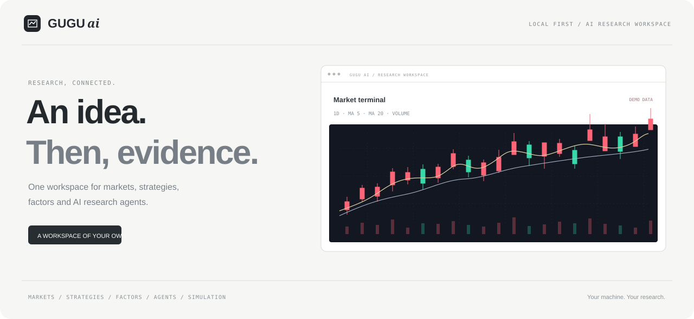

<div align="center">

<h1>GuGu ai 产品网站</h1>
<p>让每一个研究想法，有据可循。</p>

[访问网站](https://jensen-yao.github.io/gugu-site/) · [应用仓库（需访问权限）](https://github.com/Jensen-Yao/gugu)
</div>

此仓库只包含 GuGu ai 的静态展示页与部署工作流，不包含研究后端、业务数据或模型配置。

网站提供图表周期切换、策略与智能体预览、键盘导航、折叠说明和可复制的本地启动命令。所有图表均为固定示例，实际研究功能需要在本地应用中使用。

当前应用形态是本地 Web 工作台、CLI 与 Electron 桌面端。桌面端复用同一界面和本地后端，可从源码生成 Windows NSIS 安装包；公开下载站尚未发布。

## 本地预览

使用任意静态 HTTP 服务提供 `site/` 目录；例如：

```sh
python -m http.server 8080 --directory site
```

## 部署

推送 main 后，GitHub Actions 仅将 `site/` 上传到 GitHub Pages。部署不需要任何手工供应商密钥，使用 GitHub 的短期部署身份。

提交前运行 `node scripts/check-publication.mjs` 检查 Git 暂存区。

## License

网站源代码采用 [MIT](LICENSE)。Geist 字体遵循 `site/assets/fonts/` 内随附的 SIL Open Font License。
